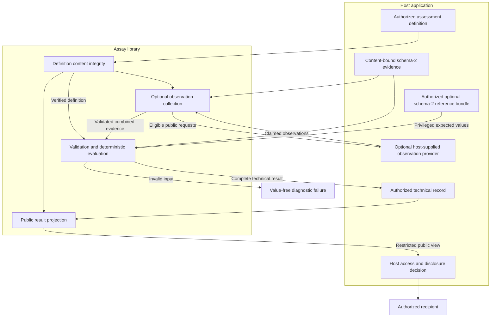
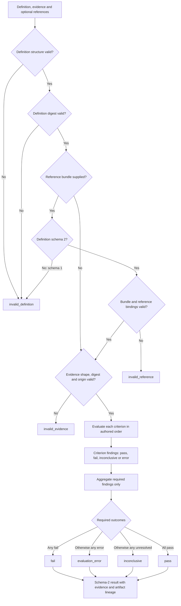
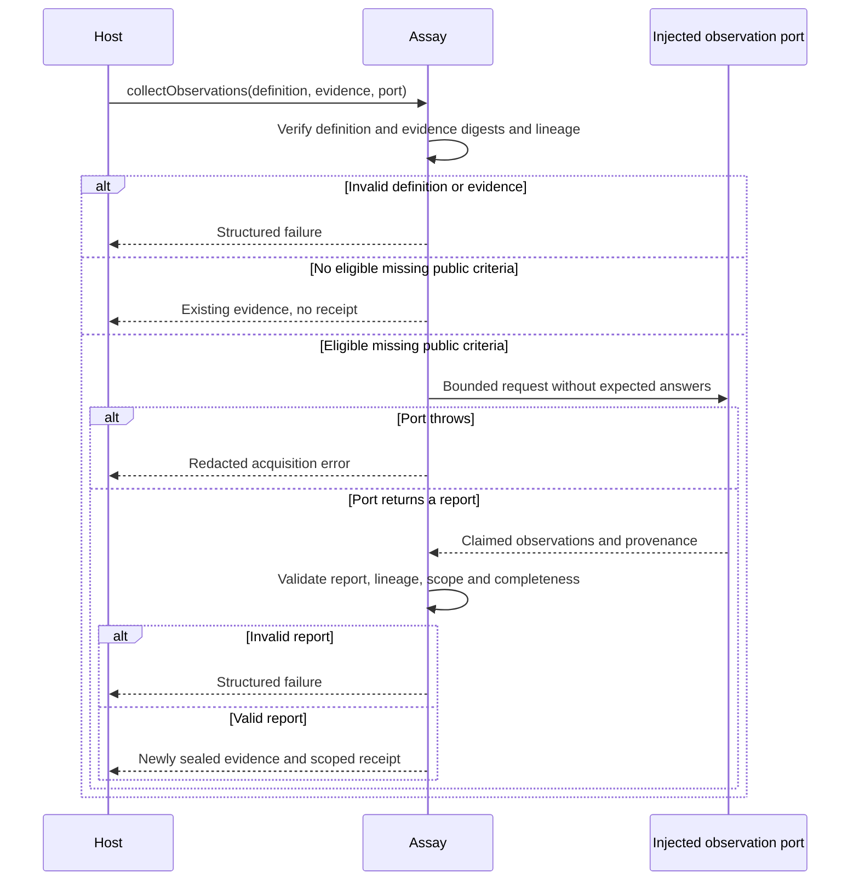
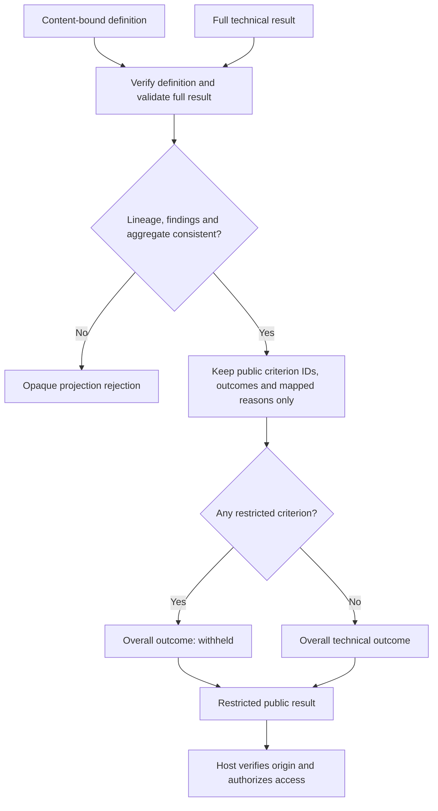

# Assay

**Deterministic technical evaluation from explicit criteria and bounded evidence.**

Assay is a standalone TypeScript library for checking technical observations against versioned assessment definitions. It produces reproducible criterion-level findings, distinguishes missing evidence from incorrect results, and can construct a deliberately restricted public-facing view.

Assay evaluates evidence; it does **not** execute learner code, authenticate a submitted observation, fetch protected reference answers, issue grades or award credentials. Those responsibilities stay with the application using it.

**Availability:** The Apache-2.0 source is public. The npm package is **not published**; its source version remains 0.0.0 with the private publication guard enabled. There is no supported npm install command yet.

## How it works

1. **Define the requirements.** Author typed criteria for exact or normalized text, numeric values with explicit tolerances and units, sets, booleans, structured JSON, selected execution facts, or manual evidence. Every assessment needs at least one required criterion.
2. **Bind the definition to its content.** Use [definition integrity](docs/integrity.md) to create or verify a deterministic, versioned SHA-256 digest. A hash identifies content; it does not authenticate its publisher.
3. **Supply observations.** Seal bounded, typed evidence with `createEvidenceBundle` or use an [optional injected observation port](docs/observations.md). A provider's claimed provenance is not independent proof of execution.
4. **Evaluate.** Supply an optional content-bound reference bundle from authorized host storage alongside the definition and evidence. Compare observations using the deterministic [evaluation semantics](docs/evaluation.md). Required findings determine the technical outcome; advisory findings cannot manufacture a pass. Invalid, missing and truncated evidence are handled distinctly.
5. **Present only appropriate findings.** The full technical record is for an authorized host. Use the [learner-safe projection](docs/projection.md) to omit restricted findings, evidence references and hidden aggregate outcomes while exposing only allowlisted public feedback. The host must still decide who is allowed to see any result.

The pure library has **no runtime dependencies**, network requirement, model provider, private workspace or mandatory executor.

## Architecture

Assay separates pure evaluation from optional evidence acquisition and public-result projection. The diagrams below describe the current source, not the proposed follow-up contracts.

### System boundary



This shows the verified evaluation path. The host supplies optional protected reference material directly to evaluation, never to observation collection or the provider. The host owns authorization, execution isolation, evidence authenticity, protected reference storage and any formal decision. Assay neither runs submitted programs nor contacts a provider unless the caller explicitly invokes collection with an injected port. A content digest is not an authentication mechanism.

### Deterministic evaluation



The `evaluate(definition, evidence, references?)` entry point validates the definition and recomputes its content digest before inspecting evidence or comparing values. A supplied reference bundle is validated before evidence, including lineage, record digests and declared kinds, units and item types. Invalid material produces a value-free `invalid_reference` failure, not a learner mismatch; supplying a bundle for a schema-1 definition returns `invalid_definition`. Omitting the bundle continues directly to evidence validation. Partial bundles are permitted; a complete observation with an unavailable reference is inconclusive. There is no unchecked public evaluation path: the evidence digest and origin scope are verified before comparison. Missing, truncated or explicitly interrupted execution evidence is inconclusive at the criterion level; a definite required failure still determines the aggregate. Manual evidence, unresolved protected references and reported execution assertions cannot establish a pass in the current implementation.

### Optional observation acquisition



Collection is separate from evaluation: the caller must pass the returned evidence to the evaluator. Restricted criteria and expected answers are not sent to the port. A valid report or receipt does not prove that execution occurred as claimed.

### Public-result disclosure



Use `projectPublicResult` for this boundary, not direct serialization of the full technical record. The projection removes evidence and artifact digests, evidence references, raw reason codes, restricted identifiers and private aggregate outcomes. It is not an authorization or attestation service.

See [architecture](docs/architecture.md) for source boundaries and the [canonical architecture and specification index](https://github.com/0xbuffdev/context/tree/main/repos/assay) for separately governed follow-up work. Mandatory definition, reference and evidence integrity are implemented. Full technical results bind the exact evidence digest and optional artifact scope; schema-2 objective comparators and direct typed execution facts are implemented; selected execution fact acquisition remains ticket-gated.

## Develop from source

Requires Node.js 24+ and pnpm 11.2.2.

```sh
git clone https://github.com/0xbuffdev/assay.git
cd assay
corepack enable
pnpm install --frozen-lockfile
pnpm check
```

The full check validates contracts, security cases, TypeScript, Biome, the tsdown ESM/types build and an **independent offline consumer of the actual npm tarball**. It does not publish or deploy anything.

Use these commands for focused work:

```sh
pnpm test
pnpm typecheck
pnpm check:style
pnpm build
pnpm verify:package
```

The last command checks the packed package after a build, using a temporary isolated ESM/TypeScript consumer. Authored TypeScript files use extensionless relative imports.

## Documentation

The [contract reference](docs/contracts.md) defines accepted input and result types. [Architecture](docs/architecture.md) explains the responsibilities of the evaluator and host. [Release and package verification](docs/releasing.md) describes the current source-quality gate and remaining publication approvals.

For changes to Assay, follow [CONTRIBUTING.md](CONTRIBUTING.md), [SECURITY.md](SECURITY.md) and the [specification](https://github.com/0xbuffdev/context/blob/main/repos/assay/specs/0001-evaluation-core.md). Accepted implementation history and decisions are maintained in the [canonical tickets](https://github.com/0xbuffdev/context/blob/main/repos/assay/tickets.md).

## License

Apache License 2.0. See [LICENSE](LICENSE) and [copyright and attribution](COPYRIGHT.md). Public source availability does not authorize an npm release.
