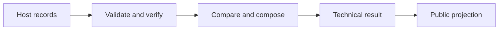
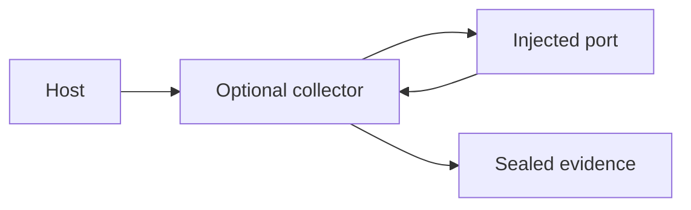

# Assay

Assay compares technical evidence against explicit, versioned criteria and returns reproducible findings. Use it in assessment systems, engineering exercises and other tools that need to distinguish a correct result from an incorrect or unresolved one.

The host supplies the evidence and authorizes the criteria. Assay does not execute submitted programs, authenticate observations, assign grades or issue credentials. The library runs offline and has no runtime dependencies.

## Installation

Requires Node.js 24 or later and ESM. Install version 0.0.1 from npm:

```sh
npm install @0xbuff/assay@0.0.1
```

For an unreleased revision, [build from source](#development).

## Quick start

This example checks a measurement against an inclusive range. The caller supplies the measurement independently; no runner or service is needed.

```ts
import {
  createAssessmentDefinition,
  createEvidenceBundle,
  evaluate,
  projectPublicResult,
} from "@0xbuff/assay";

const definition = createAssessmentDefinition({
  schemaVersion: 4,
  assessmentId: "calibration",
  revision: "rev1",
  policyVersion: "composed-required-v1",
  criteria: [
    {
      id: "voltage",
      kind: "number_range",
      mode: "required",
      visibility: "public",
      parameters: {
        expected: {
          type: "literal",
          value: { min: 98, max: 102, minInclusive: true, maxInclusive: true },
        },
        unit: "mV",
      },
    },
  ],
  composition: {
    rootGroupId: "root",
    groups: [
      {
        id: "root",
        operator: "all",
        children: [{ kind: "criterion", id: "voltage" }],
      },
    ],
  },
});
if (!definition.ok) throw new Error("Invalid definition");

const evidence = createEvidenceBundle(definition.value, {
  schemaVersion: 4,
  observations: [
    {
      criterionId: "voltage",
      evidenceRef: "measurement",
      kind: "number",
      completeness: "complete",
      value: 101,
      unit: "mV",
    },
  ],
});
if (!evidence.ok) throw new Error("Invalid evidence");

const result = evaluate(definition.value, evidence.value);
const view = projectPublicResult(definition.value, result);
if (!view.ok) throw new Error("Projection rejected");
console.log(view.value.outcome); // pass
```

A missing measurement is inconclusive. An out-of-range measurement fails; a mismatched unit makes the evidence invalid.

## Features

- Exact and normalized text, numeric tolerance and ranges, set equivalence, Boolean and JSON equality.
- Explicit `all` and `any` groups over required criteria; advisory findings cannot determine the binding outcome.
- Content-bound definitions, evidence and protected references, with deterministic SHA-256 digests.
- Selected execution facts and optional host-supplied observation collection.
- Attributed qualitative review with bounded feedback and citations. Required manual evidence remains review-needed.
- Public projection with a fixed reason vocabulary and aggregate withholding whenever a criterion is restricted.
- Bounded JSON decoding with duplicate-key rejection and value-free diagnostics.

## Architecture



The host supplies the definition, evidence and optional protected reference bundle. Evaluation verifies the definition, supplied references and evidence in that order, then compares each criterion in authored order. Complete results carry evidence lineage. Malformed records return separate diagnostic failures.



The collector requests eligible missing public facts without expected answers or restricted identifiers. Review observations come directly from the host. Keep full results privileged; authorize disclosure separately and use the public projection. Digests identify content, not its authenticity. See the [architecture guide](https://github.com/0xbuffdev/assay/blob/main/docs/architecture.md).

## Documentation

| Guide                                                                                | Contents                                  |
| ------------------------------------------------------------------------------------ | ----------------------------------------- |
| [Contracts](https://github.com/0xbuffdev/assay/blob/main/docs/contracts.md)          | Input and result types, validation limits |
| [Evaluation](https://github.com/0xbuffdev/assay/blob/main/docs/evaluation.md)        | Comparators, composition and outcomes     |
| [Integrity](https://github.com/0xbuffdev/assay/blob/main/docs/integrity.md)          | Digests, evidence lineage and versions    |
| [Observations](https://github.com/0xbuffdev/assay/blob/main/docs/observations.md)    | Acquisition and claimed provenance        |
| [Public projection](https://github.com/0xbuffdev/assay/blob/main/docs/projection.md) | Safe disclosure and host responsibilities |

The current contract uses schema 4, evaluator semantics `v0.0.5` and policy `composed-required-v1`. Earlier development schemas are unsupported. Use `decodeSerializedRecord` before validating untrusted JSON; enforce transport limits in the host.

## Development

```sh
git clone https://github.com/0xbuffdev/assay.git
cd assay
corepack enable
pnpm install --frozen-lockfile
pnpm check
```

Use Node.js 24+ and pnpm 11.2.2. The full check builds the package and verifies it with an isolated offline ESM and TypeScript consumer.

Read the [development guide](https://github.com/0xbuffdev/assay/blob/main/docs/development.md), [contribution guidelines](https://github.com/0xbuffdev/assay/blob/main/CONTRIBUTING.md) and [security policy](https://github.com/0xbuffdev/assay/blob/main/SECURITY.md). Release preparation follows the [release policy](https://github.com/0xbuffdev/assay/blob/main/docs/releasing.md).

## License

[Apache-2.0](https://github.com/0xbuffdev/assay/blob/main/LICENSE). See [copyright and attribution](https://github.com/0xbuffdev/assay/blob/main/COPYRIGHT.md).
