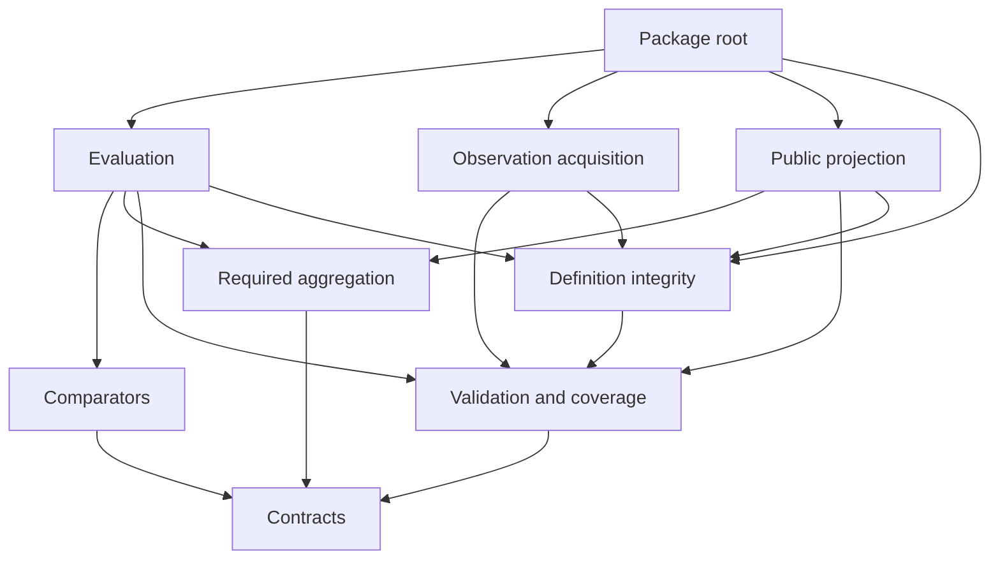

# Assay architecture

Assay is a **technical comparison engine**, not an executor, an AI judge or an academic records system. AY-I01 validates typed definitions, observations and findings; AY-I02 implements deterministic literal comparisons and fail-closed required aggregation; AY-I03 adds optional injected observation acquisition with bounded claimed provenance, not an embedded executor or trusted runner. See [Specification 0001](https://github.com/0xbuffdev/context/blob/main/repos/assay/specs/0001-evaluation-core.md) for the accepted requirements.

```text
Caller-authorized versioned criteria + typed bounded observations
                              |
                       strict validation and digest verification
                              |
                   deterministic comparators
                              |
                required/advisory aggregation
                              |
                 versioned technical findings
                              |
            consumer-owned interpretation/decision
```

The pure library must work in a clean environment without OEE, 0xNAND, AI, a runtime executor or private package. An optional host may supply observed execution results, but Assay cannot claim those results were authentically obtained. A technical `pass` never means officially credited.

The target findings distinguish `pass`, `fail`, `inconclusive`, `invalid_definition`, `invalid_evidence`, `invalid_reference` and `evaluation_error`. Invalid inputs return a separate diagnostic envelope; complete technical outcomes exclude them. Required criteria cannot be empty. Missing or incomplete evidence cannot silently pass; comparator failure is not learner deficiency.

The source exposes versioned parsing/coverage from [contracts](contracts.md), pure `evaluate` from [evaluation](evaluation.md), and an optional async [observation port](observations.md). It does **not** authenticate evidence or issue academic credit; unresolved references and unverified execution never pass.

## Source organization

AY-I11 separated internal responsibilities without changing the schema,
digest profile, outcome semantics or package-root exports. The accepted
[organization requirement ASY-32](https://github.com/0xbuffdev/context/blob/main/repos/assay/specs/0003-evaluation-semantics.md)
governs this structure.

| Module             | Responsibility                                                                                   |
| ------------------ | ------------------------------------------------------------------------------------------------ |
| `src/index.ts`     | Explicit public exports; no implementation logic                                                 |
| `src/contracts/`   | Versioned definitions, evidence, results, observation ports, projection and validation contracts |
| `src/validation/`  | Bounded snapshots and shared diagnostics, per-contract validators, evidence coverage             |
| `src/evaluation/`  | Pure orchestration, focused comparators and one required-outcome aggregation owner               |
| `src/integrity/`   | Canonical bytes, SHA-256, definition, reference and evidence integrity                           |
| `src/observation/` | Optional injected acquisition and its verified entry point                                       |
| `src/projection/`  | Privileged result checks and public-safe projection                                              |



Contracts have no dependency on evaluation, integrity, acquisition or
projection. Validation depends only on contracts and shared validators.
Integrity does not import evaluation or acquisition; both operations verify
definition integrity before inspecting evidence. Projection uses the same internal
required aggregation as evaluation after checking result correspondence. It also
shares the numeric comparator's relative-bound calculation to reject impossible
numeric decisions without inspecting evidence or reference values.
The package root is never an internal dependency.

AY-I12 makes definition integrity mandatory for `evaluate` and
`collectObservations`, removes the redundant verified aliases and retains the
schema-1 digest profile. Projection already verifies the definition. Structural
parsers and coverage inspection remain non-evaluating operations.
AY-I13 adds schema-2 objective reference declarations and independently sealed
reference records and bundles. Definition and reference integrity remain
separate from comparison; AY-I14 validates supplied bundles at the evaluation
boundary and passes their typed expected values to the same objective comparators. The
schema-1 definition canonical profile is retained. AY-I15 introduces sealed
schema-2 evidence, scoped origins and schema-2 technical results and provider
records. Evaluation and collection verify evidence before comparing or
invoking providers; collection seals combined evidence without changing
existing origins. Public projection remains schema 1 and omits evidence and
artifact digests.
The foundation gate checks the source module allowlist, permitted dependency
directions and absence of cycles; existing public export and packed-consumer
checks remain intact.

## Implementation boundaries

- **AY-I01:** implemented versioned definition/evidence contracts, bounded validation and structured diagnostics.
- **AY-I02:** implemented exact/normalized text, finite numeric tolerance, set comparators and deterministic required/advisory aggregation.
- **AY-I06:** explicit content-bound definitions and strict verified evaluator/provider entry points, with versioned portable SHA-256 canonicalization; publisher identity and runtime evidence authenticity remain host-owned.
- **AY-I07:** explicit public technical result projection that validates lineage and coherence, shows only public criterion outcomes, and withholds hidden aggregate findings; real access control remains host-owned.
- **AY-I03:** implemented optional injected bounded observation facts, claimed run/artifact/definition provenance and fail-closed protected-reference redaction. Host authentication remains outside the library.
- **AY-I04:** implemented offline tarball distribution audit, standalone ESM/TypeScript consumer and security acceptance fixtures. Tagging and publication still require separate explicit authorization.

No compatibility promise, execution engine or private host API is created by this foundation.

AY-I16 closes the result, reason, warning and binding policy contracts. Definition
validation admits only `all-required-v1`. Evaluation and projection share required
aggregation and advisory warning semantics; public disclosure remains unchanged.

AY-I17 extends the schema-2 objective kinds with boolean equality, finite
numeric ranges and bounded structured JSON equality. The existing validated
reference, evidence and coverage boundaries govern all new facts. Pure
comparators reuse the existing reason taxonomy, aggregation and disclosure.
The collector requests only public fact kinds and optional numeric units;
expected range endpoints and structured values are never sent to the port.

AY-I18 adds selected execution facts to the existing objective contracts
and validates run termination and relevant capture completeness across
evidence. Evaluation reuses the existing objective comparators and
aggregation, with no executor. AY-I19 extends the optional port with typed selectors, set item types, scoped termination claims and cooperative cancellation. Acquisition remains separate from synchronous evaluation.

AY-I20 maps validated technical reasons to a closed public feedback vocabulary,
checks criterion/reason and evidence-reference coherence, and retains opaque
rejection and unconditional aggregate withholding for restricted criteria.

AY-I21 adds explicit bounded serialized decoding in `src/validation/serialized.ts`.
The decoder rejects duplicate keys before whole-record JSON parsing, then uses
the existing snapshot owner for immutable data and byte accounting. Typed
contract validation and integrity verification remain separate. Host byte caps,
Proxy limitations and combined record accounting are documented in
[contracts](contracts.md#validation-and-safety-limits).
