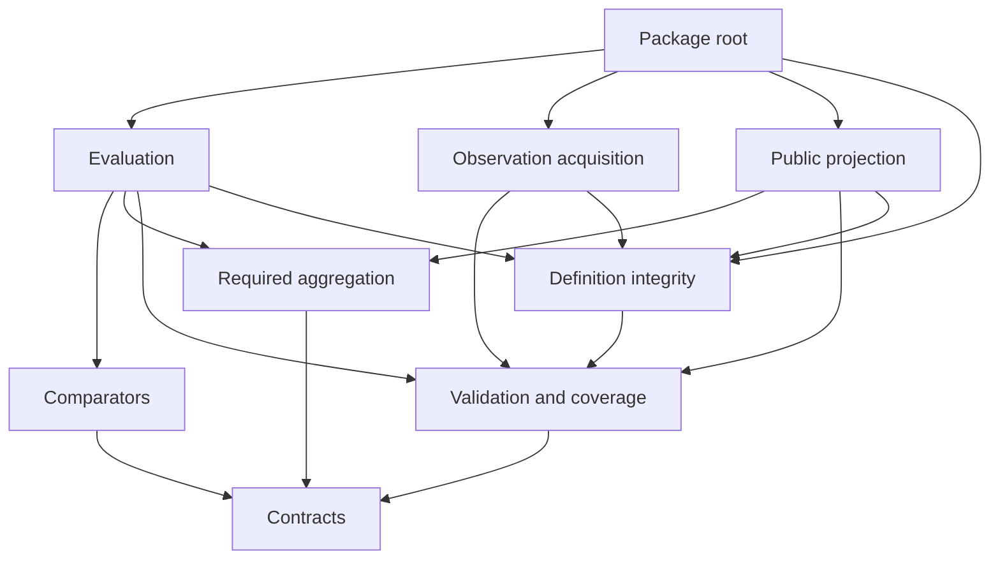

# Assay architecture

Assay compares bounded technical evidence against versioned criteria. Validation, deterministic comparison, required-outcome composition and optional observation collection are separate operations. The host owns execution, evidence authentication and formal decisions. See the [specifications](https://github.com/0xbuffdev/context/tree/main/repos/assay) for the governing contracts.

```text
Caller-authorized versioned criteria + typed bounded observations
                              |
                       strict validation and digest verification
                              |
                   deterministic comparators
                              |
                required/advisory aggregation
                              |
                 versioned technical findings
                              |
            consumer-owned interpretation/decision
```

The pure library must work in a clean environment without OEE, 0xNAND, AI, a runtime executor or private package. An optional host may supply observed execution results, but Assay cannot claim those results were authentically obtained. A technical `pass` never means officially credited.

The evaluation response distinguishes `pass`, `fail`, `inconclusive`, `invalid_definition`, `invalid_evidence`, `invalid_reference` and `evaluation_error`. Invalid inputs return a separate diagnostic envelope; complete technical outcomes exclude them. Required criteria cannot be empty. Missing or incomplete evidence cannot silently pass; comparator failure is not learner deficiency.

The source exposes versioned parsing/coverage from [contracts](contracts.md), pure `evaluate` from [evaluation](evaluation.md), and an optional async [observation port](observations.md). It does **not** authenticate evidence or issue academic credit; unresolved references and unverified execution never pass.

## Source organization

Each module owns a distinct part of the evaluation contract. The package root defines the public API; the foundation checks enforce the dependency direction.

| Module             | Responsibility                                                                                   |
| ------------------ | ------------------------------------------------------------------------------------------------ |
| `src/index.ts`     | Explicit public exports; no implementation logic                                                 |
| `src/contracts/`   | Versioned definitions, evidence, results, observation ports, projection and validation contracts |
| `src/validation/`  | Bounded snapshots and shared diagnostics, per-contract validators, evidence coverage             |
| `src/evaluation/`  | Pure orchestration, focused comparators and one required-outcome aggregation owner               |
| `src/integrity/`   | Canonical bytes, SHA-256, definition, reference and evidence integrity                           |
| `src/observation/` | Optional injected acquisition and its verified entry point                                       |
| `src/projection/`  | Privileged result checks and public-safe projection                                              |



Contracts have no dependency on evaluation, integrity, acquisition or
projection. Validation depends only on contracts and shared validators.
Integrity does not import evaluation or acquisition; both operations verify
definition integrity before inspecting evidence. Projection uses the same internal
required aggregation as evaluation after checking result correspondence. It also
shares the numeric comparator's relative-bound calculation to reject impossible
numeric decisions without inspecting evidence or reference values.
The package root is never an internal dependency.

Definition validation checks the bounded composition tree. Evaluation and projection share one implementation that combines required leaf findings through that tree. Reference, evidence, result, provider and public projection contracts all use the current generated version. No legacy adapter or duplicate aggregation path is retained. Structural parsers and coverage remain non-evaluating operations. The foundation gate preserves the module allowlist, permitted dependency directions and absence of cycles.

Qualitative review shape validation belongs to the evidence boundary (`validation/qualitative.ts`); coverage checks exact policy correspondence. The evaluator emits review-needed findings without a provider, while collection excludes review observations and projection enforces the closed review reason matrix.

## Implementation boundaries

Objective comparators share validated definition, reference, evidence and coverage contracts. The only binding policy is `composed-required-v1`; complete results use closed outcome, reason and warning vocabularies. Validation and comparison never execute submitted code.

The collector requests eligible public facts, including selected execution facts and their declared units or set item types. It validates scoped termination and provenance claims and supports cooperative cancellation. Expected values and restricted criteria stay with the authorized host. Collection is separate from synchronous evaluation.

Public projection verifies criterion, reason, evidence-reference and aggregate coherence. It maps reasons to a finite public vocabulary, withholds the aggregate whenever a criterion is restricted and rejects incoherent results with an opaque error.

`src/validation/serialized.ts` rejects duplicate JSON keys before whole-record parsing and uses the shared snapshot validator for immutable data and byte accounting. Contract validation and integrity verification follow separately. See [validation and safety limits](contracts.md#validation-and-safety-limits) for host byte caps, Proxy limitations and combined record accounting.

The [development guide](development.md) describes source and offline installed-package verification. The [release policy](releasing.md) covers publication approval.
